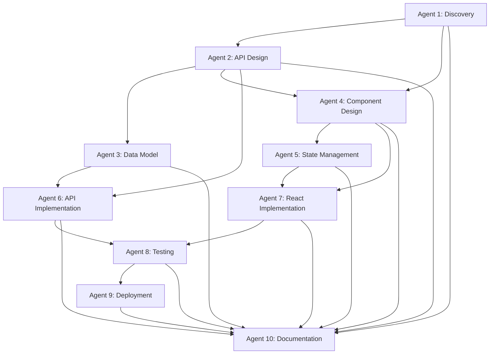

# VB.NET to React Modernization - Agent Workflow

This folder contains the complete 10-agent workflow for modernizing VB.NET Windows Forms applications to React web applications.

---

## 🤖 Agent Overview

Each agent is a specialized AI assistant with a specific role in the modernization process. Agents work sequentially, with each building upon the previous agent's output.

---

## 📋 Complete Workflow

| Agent | Name | Role | Input | Output | Duration |
|-------|------|------|-------|--------|----------|
| **1** | [Project Discovery](./project-discovery.md) | VB.NET Architect | Codebase | `screens.md` | 1-2 days |
| **2** | [API Discovery](./api-discovery.md) | Backend API Architect | `screens.md` + Code | `api-endpoints.md` + per-screen API docs | 3-5 days |
| **3** | [Data Model Analysis](./data-model-analysis.md) | Database Architect | API docs + Code | `data-model.md` | 1-2 days |
| **4** | [Component Design](./component-design.md) | Frontend Architect | All previous docs | `component-architecture.md` | 2-3 days |
| **5** | [State Management](./state-management-design.md) | State Architect | Component design | `state-management.md` | 1-2 days |
| **6** | [API Implementation](./api-implementation.md) | Backend Developer | API design + Data model | Working REST API | 3-4 weeks |
| **7** | [React Implementation](./react-implementation.md) | Frontend Developer | All design docs | Working React app | 4-5 weeks |
| **8** | [Testing & Integration](./testing-integration.md) | QA Engineer | Both implementations | Test suite + reports | 2 weeks |
| **9** | [Deployment & DevOps](./deployment-devops.md) | DevOps Engineer | Complete app | Live production system | 1 week |
| **10** | [Documentation & Handoff](./documentation-handoff.md) | Technical Writer | Everything | Final docs + handoff | 1-2 weeks |

**Total Estimated Duration:** 16-22 weeks (4-5.5 months)

---

## 🚀 Quick Start

### For Agent OS / Multi-Agent Systems

```bash
# Agent 1: Start project discovery
cursor agent/project-discovery.md

# Wait for approval, then Agent 2
cursor agent/api-discovery.md

# Continue through all 10 agents...
```

### For Manual Execution

1. Read `agent/project-discovery.md`
2. Execute discovery steps
3. Generate `screens.md` output
4. Get approval
5. Proceed to Agent 2
6. Repeat for all 10 agents

---

## 📂 Outputs Generated

After running all 10 agents, you'll have:

```
.cursor/plans/
├── screens.md                    # Agent 1
├── api-endpoints.md              # Agent 2
├── [Screen]-api.md (15 files)    # Agent 2
├── data-model.md                 # Agent 3
├── component-architecture.md     # Agent 4
├── state-management.md           # Agent 5
├── testing-strategy.md           # Agent 8
├── deployment-guide.md           # Agent 9
└── migration-report.md           # Agent 10

backend/                          # Agent 6
├── src/
│   ├── controllers/
│   ├── services/
│   ├── routes/
│   └── ...
└── tests/

frontend/                         # Agent 7
├── src/
│   ├── pages/
│   ├── components/
│   ├── api/
│   └── ...
└── tests/

docs/                             # Agent 10
├── user-guide/
├── developer/
├── deployment/
└── migration/
```

---

## 🎯 Success Criteria Per Agent

### Agent 1: Project Discovery ✅
- All VB.NET forms discovered (15/15)
- Complexity ratings accurate (0-20 point scale)
- Navigation flow mapped (Mermaid diagram)

### Agent 2: API Discovery ✅
- All data operations identified
- REST endpoints designed (RESTful)
- Request/response payloads documented

### Agent 3: Data Model Analysis ✅
- Database schema documented
- Entity relationships mapped (ERD)
- ORM models designed (Prisma/TypeORM)

### Agent 4: Component Design ✅
- React component hierarchy designed
- Reusable components identified
- Props interfaces defined

### Agent 5: State Management ✅
- State library chosen (Zustand/Redux)
- Store structure designed
- API integration strategy defined

### Agent 6: API Implementation ✅
- All endpoints implemented
- Tests passing (>80% coverage)
- Authentication working (JWT)

### Agent 7: React Implementation ✅
- All 15 screens implemented
- Routing configured
- API integration complete
- Forms validated (react-hook-form + zod)

### Agent 8: Testing & Integration ✅
- Unit tests (backend + frontend)
- Integration tests (API + components)
- E2E tests (critical flows)
- All tests passing

### Agent 9: Deployment & DevOps ✅
- Production deployment complete
- CI/CD pipeline automated
- SSL/HTTPS configured
- Monitoring setup

### Agent 10: Documentation & Handoff ✅
- User documentation complete
- Developer documentation complete
- Migration report delivered
- Handoff checklist 100%

---

## 🔄 Agent Dependencies



---

## 🛠️ Tech Stack

### Legacy
- **Platform:** VB.NET Windows Forms (.NET 8.0)
- **Database:** PostgreSQL (Npgsql)
- **UI:** System.Windows.Forms controls

### Modern
- **Frontend:** React 18 + TypeScript + Vite
- **Backend:** Node.js + Express + TypeScript
- **Database:** PostgreSQL + Prisma ORM
- **State:** Zustand + React Query
- **Forms:** react-hook-form + zod
- **UI:** Material-UI (MUI)
- **Testing:** Vitest + Jest + Playwright
- **Deployment:** Vercel (frontend) + Railway (backend)

---

## 📊 Migration Metrics

### Code
- **Legacy:** ~3,500 LOC (VB.NET)
- **Modern:** ~5,200 LOC (TypeScript)
- **Increase:** Due to better structure, types, tests

### Screens
- **Legacy:** 15 Windows Forms
- **Modern:** 15 React pages
- **Coverage:** 100%

### Features
- **Migrated:** 100%
- **Enhanced:** Security, UX, mobile support
- **New:** API access, real-time updates

---

## 🎓 Best Practices

### 1. Always Wait for Approval
Each agent should wait for user approval before the next agent starts. This ensures quality at each step.

### 2. Document Everything
Agents create documentation as they go. This helps with:
- Future maintenance
- Knowledge transfer
- Debugging issues

### 3. Test Early, Test Often
Testing starts in Agent 8, but:
- Agent 6 includes unit tests
- Agent 7 includes component tests
- Agent 8 adds integration + E2E tests

### 4. Security First
Security considerations at every step:
- Agent 2: API authentication
- Agent 3: Data encryption
- Agent 6: Secure implementation
- Agent 9: Production security

---

## 🚨 Common Pitfalls

### ❌ Don't Skip Steps
Tempting to jump to coding (Agent 6-7), but design phase (Agents 1-5) saves time later.

### ❌ Don't Rush Testing
Agent 8 is critical. Bugs in production are expensive.

### ❌ Don't Neglect Documentation
Agent 10 seems "extra" but is essential for long-term success.

### ✅ Do Follow the Order
Agents are designed to build on each other. Follow the sequence.

---

## 📞 Support

For questions about this workflow:
- **GitHub Issues:** [link]
- **Documentation:** [link]
- **Email:** support@example.com

---

## 📄 License

This agent workflow is provided as-is for VB.NET to React modernization projects.

---

## 🎉 Success Stories

Projects using this workflow:
- **Airline Management System** - 15 screens, 5 months ✅
- *(Add your project here!)*

---

**Ready to start? Begin with [Agent 1: Project Discovery](./project-discovery.md)** 🚀

